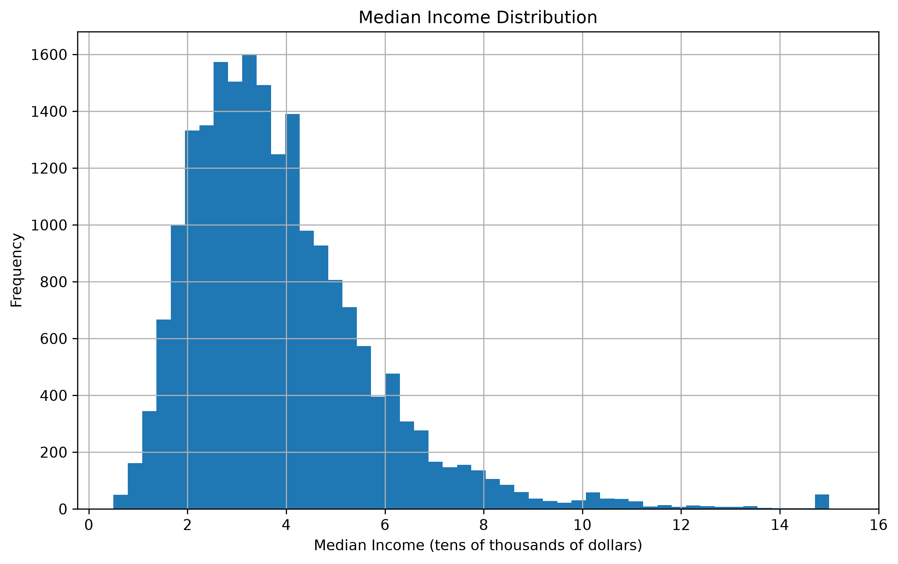
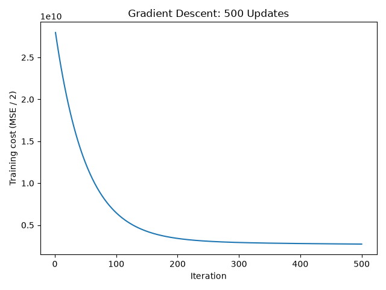
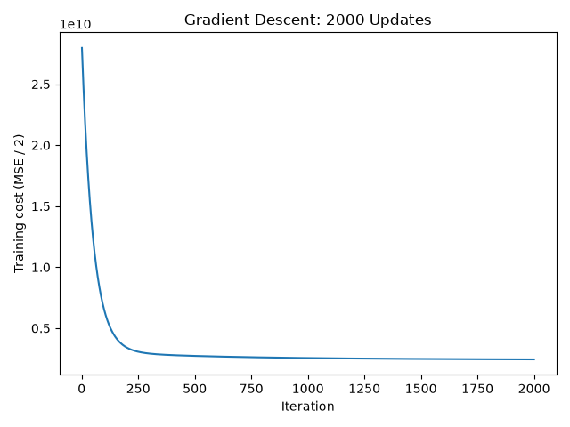
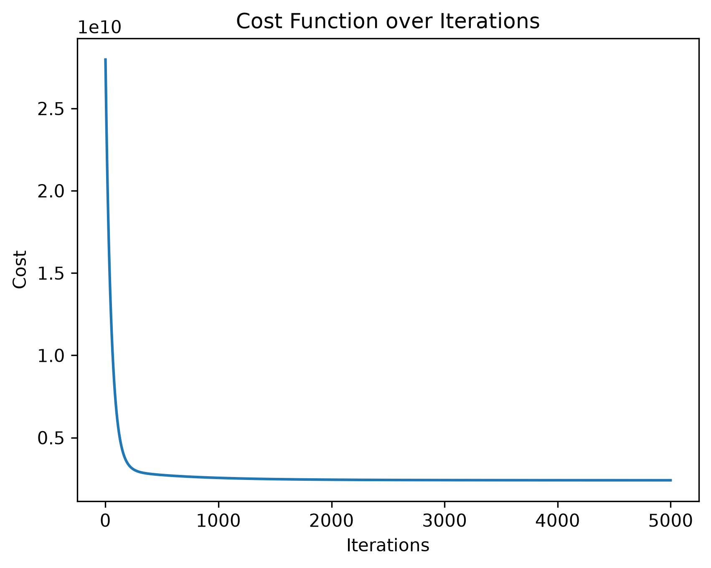
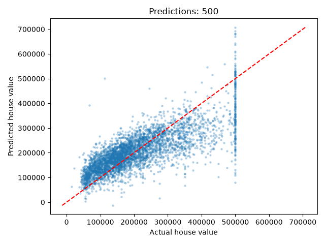
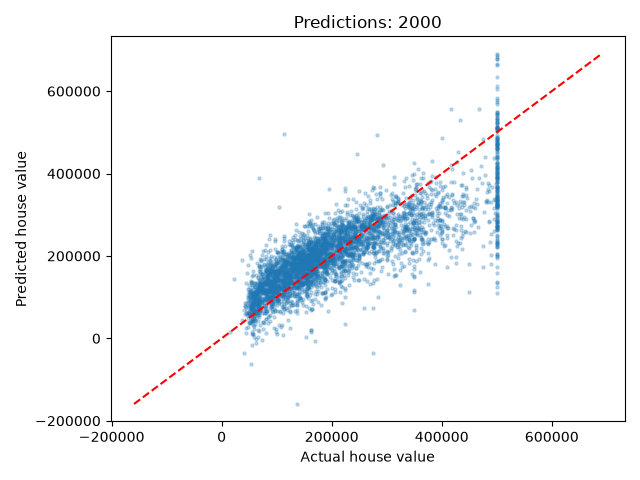
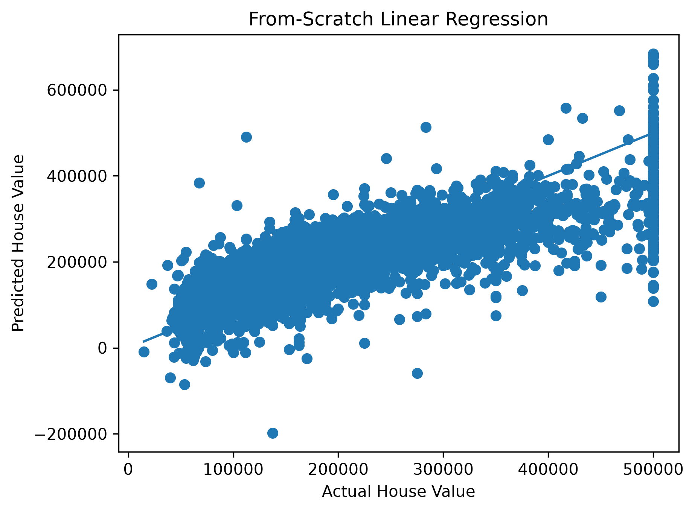
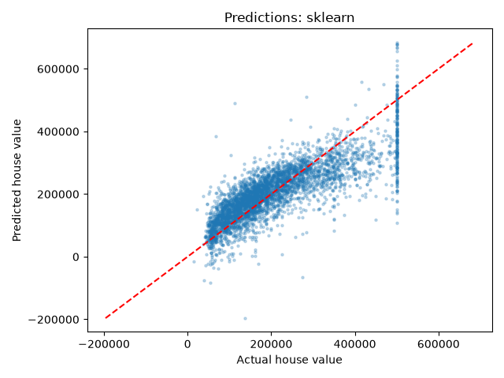

# Linear Regression From Scratch

A hands-on implementation of **Linear Regression from scratch using NumPy and Batch Gradient Descent**, followed by a comparison with Scikit-learn's `LinearRegression`.

The goal of this project is to understand what happens inside a Linear Regression model instead of treating the implementation as a black box.

---

## Overview

This project uses the **California Housing dataset** to build and evaluate a Linear Regression model from scratch.

The project covers:

- Data inspection and cleaning
- Exploratory Data Analysis (EDA)
- Train/test splitting
- Feature standardization
- Linear Regression from scratch
- Batch Gradient Descent
- Cost function and gradient calculation
- Optimization and convergence
- Model evaluation
- Prediction visualization
- Comparison with Scikit-learn

A major part of the experiment investigates how increasing the number of Gradient Descent iterations affects the model.

Three training configurations were tested:

- **500 iterations**
- **2000 iterations**
- **5000 iterations**

The resulting cost curves and prediction plots are compared to visualize how the model approaches the optimized solution.

---

# Dataset

The project uses the **California Housing dataset**.

## Target

`median_house_value`

## Numerical Features

- `longitude`
- `latitude`
- `housing_median_age`
- `total_rooms`
- `total_bedrooms`
- `population`
- `households`
- `median_income`

The categorical feature `ocean_proximity` was removed for this first implementation so that the model could operate directly on numerical features.

---

# Data Preparation

The dataset was inspected using Pandas through:

- `head()`
- `describe()`
- `info()`
- Missing-value checks
- Duplicate checks

There were missing values in `total_bedrooms`. These rows were removed before training.

Exploratory analysis was performed using:

- Histograms
- Box plots
- Feature-vs-target scatter plots

The dataset was then split into:

- **80% training data**
- **20% testing data**

A fixed `random_state=42` was used for reproducibility.

## Feature Standardization

The numerical features were standardized using the **training-set mean and standard deviation**:

$$
x_{\text{scaled}} =
\frac{x-\mu_{\text{train}}}
{\sigma_{\text{train}}}
$$

The same training statistics were applied to the test set to avoid data leakage.

---

## Median Income Distribution

The distribution of `median_income` was visualized before training.



The distribution is right-skewed, with most observations concentrated toward lower and middle income values and a smaller number of high-income observations.

---

# Linear Regression From Scratch

The prediction function for the model is:

$$
\hat{y}=XW+b
$$

where:

- $X$ = feature matrix
- $W$ = weight vector
- $b$ = bias
- $\hat{y}$ = predicted values

The weights and bias were initialized and optimized using **Batch Gradient Descent**.

---

# Cost Function

The model uses the Mean Squared Error-based cost function:

$$
J(W,b)=
\frac{1}{2m}
\sum_{i=1}^{m}
(\hat{y}_i-y_i)^2
$$

The factor $\frac{1}{2}$ simplifies the derivative of the squared error.

---

# Gradient Descent

The weight gradient is:

$$
\nabla_W J =
\frac{1}{m}X^T(\hat{y}-y)
$$

The bias gradient is:

$$
\nabla_b J =
\frac{1}{m}\sum_{i=1}^{m}(\hat{y}_i-y_i)
$$

The parameters are updated using:

$$
W \leftarrow W-\alpha\nabla_WJ
$$

$$
b \leftarrow b-\alpha\nabla_bJ
$$

where $\alpha$ is the learning rate.

## Training Configuration

| Parameter | Value |
|---|---:|
| Learning rate | `0.01` |
| Optimization | Batch Gradient Descent |
| Initial weights | Zeros |
| Initial bias | `0` |
| Iteration experiments | `500`, `2000`, `5000` |

---

# Gradient Descent Convergence

To investigate the effect of training duration, the model was trained using three different numbers of iterations.

## 500 Iterations



After 500 iterations, the cost has decreased substantially from its initial value, but the optimization process has not yet fully converged.

## 2000 Iterations



At 2000 iterations, the cost decreases further and the curve becomes considerably flatter.

## 5000 Iterations



At 5000 iterations, the cost curve is very close to its stable minimum.

## Convergence Observation

The three experiments demonstrate the progression:

**500 → 2000 → 5000 iterations**

The largest improvement occurs during the earlier iterations. As the model approaches the minimum of the cost function, each additional iteration produces a progressively smaller improvement.

This demonstrates **diminishing returns during optimization**.

---

# Model Evaluation

The trained model was evaluated on the unseen test set using three metrics.

## Mean Squared Error

$$
MSE=
\frac{1}{n}
\sum_{i=1}^{n}
(y_i-\hat{y}_i)^2
$$

MSE penalizes larger errors more heavily because the errors are squared.

## Root Mean Squared Error

$$
RMSE=\sqrt{MSE}
$$

RMSE converts the error back to the original target units, making it easier to interpret.

## R² Score

$$
R^2=
1-
\frac{
\sum(y_i-\hat{y}_i)^2
}{
\sum(y_i-\bar{y})^2
}
$$

R² measures how much of the variation in the target is explained by the model relative to predicting the mean target value.

---

# Results

Three different Gradient Descent training durations were tested to investigate how the number of iterations affects model performance.

| Model | Iterations | MSE | RMSE | R² |
|---|---:|---:|---:|---:|
| From Scratch | 500 | 5,649,055,697.10 | 75,160.20 | 0.5872 |
| From Scratch | 2000 | 5,007,642,485.04 | 70,764.70 | 0.6339 |
| From Scratch | 5000 | 4,922,707,617.40 | 70,162.01 | 0.6401 |
| Scikit-learn | — | 4,921,881,237.63 | 70,156.12 | 0.6402 |

The results clearly show the effect of additional Gradient Descent iterations.

At 500 iterations, the from-scratch model achieves an R² of approximately **0.5872**.

Increasing the training duration to 2000 iterations improves the R² to **0.6339**.

At 5000 iterations, the R² reaches **0.6401**, which is extremely close to the Scikit-learn result of **0.6402**.

The RMSE follows the same pattern:

- 500 iterations: **75,160.20**
- 2000 iterations: **70,764.70**
- 5000 iterations: **70,162.01**
- Scikit-learn: **70,156.12**

The improvement becomes smaller as the number of iterations increases, which is consistent with the convergence behavior observed in the cost-function plots.

---

# 5000 Iterations vs Scikit-learn

The final from-scratch model trained for 5000 iterations was compared directly with Scikit-learn's `LinearRegression`.

| Metric | From Scratch — 5000 | Scikit-learn | Difference |
|---|---:|---:|---:|
| MSE | 4,922,707,617.40 | 4,921,881,237.63 | ~826,380 |
| RMSE | 70,162.01 | 70,156.12 | ~5.89 |
| R² | 0.6401 | 0.6402 | ~0.00007 |

The difference is extremely small.

The 5000-iteration implementation achieves almost the same performance as Scikit-learn's optimized Linear Regression implementation.

This demonstrates that the manually implemented Batch Gradient Descent algorithm successfully converges toward the optimal Linear Regression parameters.

---

# Prediction Results

The prediction plots provide another way to observe the effect of increasing the number of Gradient Descent iterations.

The ideal prediction behavior would place the points close to the diagonal line:

$$
\hat{y}=y
$$

where predicted values equal the actual house values.

---

## 500 Iterations



The 500-iteration model captures the general relationship between actual and predicted house values, but there is still substantial spread around the ideal diagonal.

---

## 2000 Iterations



After 2000 iterations, the predictions move closer to the optimized solution.

The improvement is consistent with the reduction in the cost function and the improvement in RMSE and R².

---

## 5000 Iterations



After 5000 iterations, the prediction plot is very close to the final optimized solution.

The model achieves an RMSE of **70,162.01** and an R² of **0.6401**.

---

# Scikit-learn Comparison

The final 5000-iteration from-scratch model was compared with Scikit-learn's `LinearRegression`.

## From-Scratch Model — 5000 Iterations


## Scikit-learn Linear Regression



The prediction plots are extremely similar.

This visual similarity is also supported by the numerical results: the difference in RMSE is only approximately **5.89**, while the R² difference is approximately **0.00007**.

This confirms that the from-scratch implementation has effectively converged to the same solution as the Scikit-learn implementation.

---

# Key Takeaways

## 1. Linear Regression is simple mathematically

The model ultimately makes predictions using:

$$
\hat{y}=XW+b
$$

The main optimization challenge is finding the values of $W$ and $b$ that minimize the cost function.

---

## 2. Gradient Descent is an optimization algorithm

Instead of directly calculating the optimal parameters, Gradient Descent repeatedly updates the parameters in the direction that reduces the cost.

Each iteration uses the gradients of the cost function to determine how the weights and bias should change.

---

## 3. More iterations improve the model until convergence

The experiment showed:

**500 → 2000 → 5000 iterations**

| Iterations | RMSE | R² |
|---:|---:|---:|
| 500 | 75,160.20 | 0.5872 |
| 2000 | 70,764.70 | 0.6339 |
| 5000 | 70,162.01 | 0.6401 |

The model improved substantially between 500 and 2000 iterations.

However, the improvement from 2000 to 5000 iterations was much smaller.

This demonstrates **diminishing returns during optimization**.

---

## 4. Standardization helps Gradient Descent

Standardizing the features places them on comparable scales.

This makes the optimization process more stable and prevents features with larger numerical magnitudes from dominating the gradient updates.

---

## 5. Implementing the algorithm from scratch makes the process clearer

Scikit-learn hides the optimization details behind a simple `.fit()` call.

Implementing Linear Regression manually makes it possible to directly observe:

- Predictions
- Errors
- Cost
- Gradients
- Weight updates
- Bias updates
- Convergence
- Effect of iteration count

This provides a better understanding of what happens inside a machine-learning model.

---

## 6. The from-scratch implementation successfully reproduces the library solution

After 5000 iterations, the from-scratch implementation achieved:

- **RMSE: 70,162.01**
- **R²: 0.6401**

while Scikit-learn achieved:

- **RMSE: 70,156.12**
- **R²: 0.6402**

The extremely small difference demonstrates that the manually implemented Gradient Descent algorithm successfully approaches the same Linear Regression solution.

---

# Technologies

- Python
- NumPy
- Pandas
- Matplotlib
- Scikit-learn
- Jupyter Notebook

---

# Project Structure

```text
linear-regression/
│
├── data/
│   ├── california_housing.csv
│   └── 1-s2.0-S0142061515300429-main.pdf
│
├── images/
│   ├── median_income_distribution.png
│   │
│   ├── cost_function_500.png
│   ├── cost_function_2000.png
│   ├── cost_function_5000.png
│   │
│   ├── predictions_from_scratch_500.png
│   ├── predictions_from_scratch_2000.png
│   ├── predictions_from_scratch_5000.png
│   └── predictions_sklearn.png
│
├── notebook.ipynb
├── README.md
├── requirements.txt
└── .gitignore